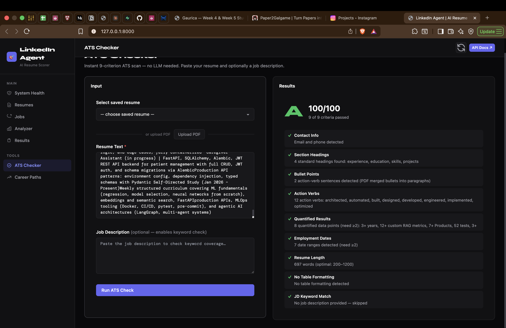
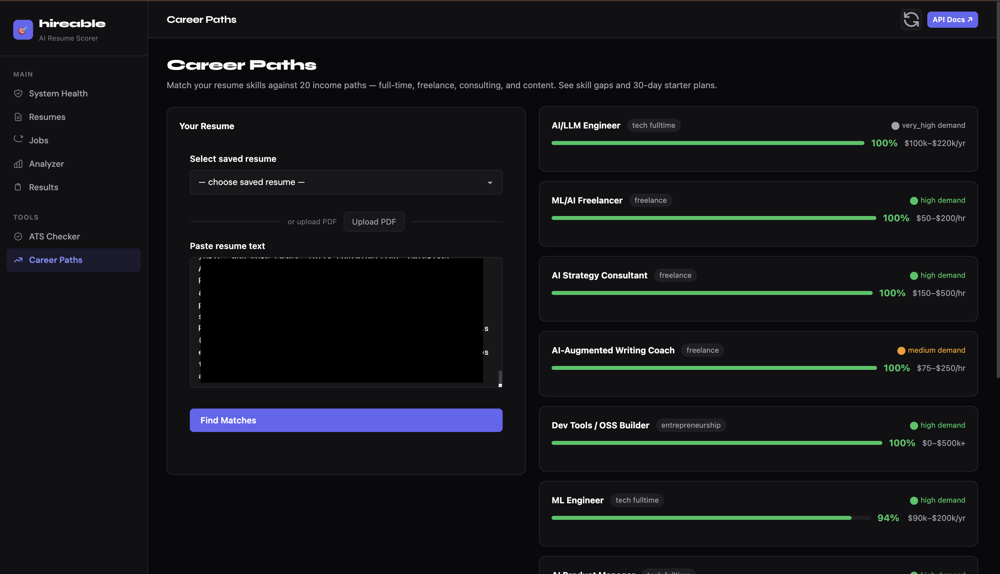

# hireable


An LLM-as-judge pipeline that scores resume-to-job fit across 5 independent dimensions, runs an instant ATS compliance check, matches your skills against 20 income paths, and generates a tailored resume and role-specific interview prep — running entirely locally via Ollama with no cloud dependency or API costs.

---

## Why this exists

Job applications involve problems most tools ignore:

1. **Opaque scoring** — applicant tracking systems score resumes without explanation. You don't know if you're failing on skills, seniority match, domain fit, or something else.
2. **Generic advice** — "add more keywords" doesn't tell you which keywords, whether your experience framing is wrong, or whether you're applying to jobs above or below your actual level.
3. **No path awareness** — a resume score against one JD doesn't tell you which income paths you're actually positioned for right now.

This pipeline makes scoring transparent and advice specific. Each judge explains its reasoning. The coach only rewrites bullets that already exist — it never invents experience or fabricates metrics. If a gap is real, it flags it as a gap rather than masking it.

The system runs locally because resume data is personal. Nothing leaves your machine.

---

## What it does

### Analyzer — 5-judge LLM pipeline
Score a resume against a job description across 5 independent dimensions. Each judge runs a structured prompt, parses the JSON response, and returns a score + gap list. All five run concurrently before the coach synthesises.

### ATS Checker — instant structural scan
9-criterion heuristic check with no LLM. Results in under a second. PDF-aware: correctly handles text where pypdf/pdfminer strips bullet characters and collapses section headings.



### Career Paths — skill-to-income matching
Scores your resume skills against 20 income paths (full-time, freelance, consulting, content). Shows match %, gaps in required skills, and a 30-day starter plan per path. No LLM — pure skill token overlap scoring.



---

## How the pipeline works

```
Resume + Job Description
         │
         ├─► ATS Pre-flight (instant, no LLM)
         │    9 criteria: contact info, headings, bullets,
         │    action verbs, quantification, dates, length,
         │    no tables, JD keyword match
         │
         ▼
┌────────────────────────────────────────┐
│         5 Parallel LLM Judges          │
│                                        │
│  Skills (25%)    → skill gap analysis  │
│  Experience (25%)→ depth + relevance   │
│  Seniority (20%) → level match         │
│  Relevancy (15%) → domain alignment    │
│  Impact (15%)    → quantified outcomes │
└────────────────────────────────────────┘
         │
         ▼
   Weighted score (0–100%)
         │
         ▼
┌────────────────────────────────────────┐
│            Coach Judge                 │
│                                        │
│  bullet_rewrite  → reframe existing    │
│  deletion        → remove irrelevant   │
│  gap_warning     → flag real gaps      │
└────────────────────────────────────────┘
         │
         ├─► Tailored resume  (results/tailored_resumes/)
         └─► Interview prep   (results/interview_prep/)
```

Each judge runs a structured prompt against the LLM, parses the JSON response, and returns a score + reasoning. The pipeline runs all 5 judges concurrently (asyncio) before the coach synthesises across them.

The coach deduplicates recommendations across judges before generating rewrites. `gap_warning` items are informational — they surface real skill gaps without pretending the resume can be edited to fix them.

---

## Model selection

The pipeline uses **`deepseek-r1:14b`** as the judge model. This was chosen after benchmarking all locally-available models across 6 resume-job pairs (including a deliberate wrong-fit pair to test discrimination).

Criteria ranked in order:
1. **Judge parse success rate** — does the model reliably return valid structured JSON across all 6 judges?
2. **Discrimination accuracy** — does it correctly score a Java engineer low against a Data Scientist role?
3. **Latency** — time per full pipeline run on local hardware

`deepseek-r1:14b` passed all 6 judges on all test pairs and correctly identified the wrong-fit case. Its chain-of-thought reasoning style (`<think>` tokens) produces more reliable structured output than instruction-tuned models that tend to hallucinate JSON fields or collapse scores to round numbers.

To run the benchmark yourself:

```bash
python benchmark_models.py
```

Results are written to `benchmark_results.json`. The pipeline uses whatever model you configure in `.env` — defaults to `deepseek-r1:14b`.

---

## Stack

| Layer | Technology | Why |
|-------|-----------|-----|
| Backend | FastAPI + Uvicorn | Async-native, suits concurrent judge calls |
| LLM runtime | Ollama | Local inference, model switching without code changes |
| Judge model | deepseek-r1:14b | Best structured-output reliability in benchmark |
| LLM client | LangChain Ollama | Thin wrapper for chat message formatting |
| Persistence | SQLite (db.py) | Run history, scores, tailored text — survives server restarts |
| Frontend | Single-file `dashboard.html` | Zero build step, no framework dependency |
| Data store | CSV + JSON | Portable, readable, easy to gitignore selectively |

---

## Setup

**Prerequisites:** [Ollama](https://ollama.com) installed and running.

```bash
# Pull the judge model
ollama pull deepseek-r1:14b
ollama serve
```

**Install dependencies:**

```bash
# Conda (recommended)
conda env create -f environment.yml
conda activate hireable

# Or pip
pip install -r requirements.txt
```

**Configure environment:**

```bash
cp .env.example .env
# Edit .env — set OLLAMA_MODEL if you want a different model
```

---

## Run

```bash
uvicorn linkedin_api:app --reload
```

Open `http://localhost:8000` in a browser.

1. Add a resume and job description via the **Resumes** and **Jobs** tabs — or paste directly in the Analyzer
2. Go to **Analyzer** → select resume + job → click **Run Analysis**
3. Results appear in the **Results** tab with scores, gaps, and coach recommendations
4. From any result, generate a **Tailored Resume** or **Interview Prep**

For instant checks without running the full LLM pipeline:
- **ATS Checker** → paste resume (or select saved / upload PDF) → instant 9-criterion structural scan
- **Career Paths** → paste resume → ranked match against 20 income paths with gap analysis

---

## API endpoints

| Endpoint | Description |
|----------|-------------|
| `POST /analyze` | Run all 5 judges + coach on a resume-job pair |
| `POST /ats-check` | Instant ATS scan — no LLM, 9 criteria |
| `POST /skill-match` | Score resume skills against 20 income paths |
| `POST /edit_resume` | Apply coach recommendations → tailored resume |
| `POST /interview_prep` | Generate role-specific questions + model answers |
| `GET /list_results` | List all saved pipeline results |
| `GET /resumes` | List resumes in data store |
| `GET /jobs` | List jobs in data store |
| `POST /extract-pdf` | Extract text + structured fields from PDF resume |
| `POST /fetch-job-url` | Scrape and clean job description from URL |

Auto-generated docs at `http://localhost:8000/docs` when server is running.

---

## Data files

| File | Description |
|------|-------------|
| `data/resumes.csv` | Resumes — see `resumes.sample.csv` for format |
| `data/jobs.csv` | Job descriptions — see `jobs.sample.csv` for format |
| `data/labels.csv` | Optional human labels for evaluation |
| `data/skills_taxonomy.json` | 10 skill domains → canonical tokens used by skills judge |
| `data/income_paths.json` | 20 income paths with required skills, income ranges, starter plans |
| `data/runs.db` | SQLite run history — gitignored |

To prevent git from tracking personal data after initial commit:

```bash
git update-index --skip-worktree data/resumes.csv data/jobs.csv data/labels.csv
```

---

## Results structure

All outputs are saved locally and never committed:

```
results/
├── pipeline/           # Full judge pipeline JSON per run
├── skills_judge/       # Individual judge outputs
├── experience_judge/
├── seniority_judge/
├── relevancy_judge/
├── impact_judge/
├── coach_judge/
├── tailored_resumes/   # Generated .txt files
├── interview_prep/     # Generated .json files
└── summary/            # Score summaries
```

---

## Project structure

```
hireable/
├── linkedin_api.py         # FastAPI app — all endpoints
├── specialized_judges.py   # Judge prompts, LLM calls, JSON parsing, coach
├── ats_checker.py          # 9-criterion ATS heuristic scanner (no LLM)
├── chunker.py              # Text parsing and prompt formatting per judge
├── db.py                   # SQLite persistence for run history
├── benchmark_models.py     # Model selection benchmark
├── dashboard.html          # Frontend — all views in one file
├── data/
│   ├── resumes.csv             # gitignored after initial commit
│   ├── jobs.csv                # gitignored after initial commit
│   ├── labels.csv              # gitignored after initial commit
│   ├── income_paths.json       # 20 income paths for Career Paths tab
│   ├── skills_taxonomy.json    # skill domain → token mapping
│   ├── resumes.sample.csv      # format reference
│   └── jobs.sample.csv         # format reference
├── tests/
├── requirements.txt
├── environment.yml
└── .env.example
```

---

## Scoring internals

The LLM's job is structured extraction, not scoring. Each judge returns a JSON array of labelled items. All arithmetic happens in Python after the LLM responds.

**Skills & Experience — partial credit**

```
score = (present + 0.5 × partial) / total
```

**Seniority — binary**

```
score = demonstrated / total
```

**Relevancy — binary**

```
score = relevant / total
```

**Impact — three-way**

```
score = (quantified + 0.5 × directional) / total
```

**Final weighted score**

```
overall = skills×0.25 + experience×0.25 + seniority×0.20 + relevancy×0.15 + impact×0.15
```

Weights are defined in `JUDGE_DEFAULT_WEIGHTS` in `specialized_judges.py`.

This two-stage design — LLM extracts and labels, Python scores — means the score is deterministic given the LLM's labels. Inconsistency shows up as label noise, which is easier to debug than an LLM producing a raw number with no audit trail.

---

## ATS Checker internals

Runs 9 heuristic criteria on plain text — no LLM, results in under a second.

PDF-aware: pypdf and pdfminer strip bullet characters (•, ▪) and can collapse section heading line breaks when extracting text. The checker handles this with:
- **Section headings**: broad word-presence match + ALL-CAPS line detection (not strict line-boundary regex)
- **Bullet points**: counts explicit bullet chars AND proxy bullet lines (medium-length lines starting with a capital letter or action verb)
- **Quantification**: matches numbers with `+` suffix (`12+`, `5,000+`), domain nouns (`metrics`, `datasets`, `tests`), and standard units

---

## Limitations

**Claims are not verified.** The judges score what the resume says. A fabricated metric or exaggerated title passes if it's plausible.

**PDF extraction quality matters.** Scanned PDFs, two-column layouts, and graphics-heavy templates produce garbled text. Plain text or single-column PDFs extract cleanly.

**Skills not in the taxonomy get missed.** The skills judge uses `data/skills_taxonomy.json` as a token vocabulary. Extend the taxonomy file for niche tools.

**Job URL scraping is best-effort.** Works on Greenhouse, Lever, Workable, most company career pages. Fails on LinkedIn (requires auth).

**Scores don't predict hiring outcomes without calibration.** The judges measure resume-to-JD textual fit, not recruiter preferences or team culture. Use the outcomes feedback loop (record interview/offer results via `/record_outcome`) to calibrate weights to your real signal.

**Local inference speed.** A full pipeline run takes 30–90 seconds on a modern Mac with `deepseek-r1:14b` loaded. Cold start adds ~20s.
