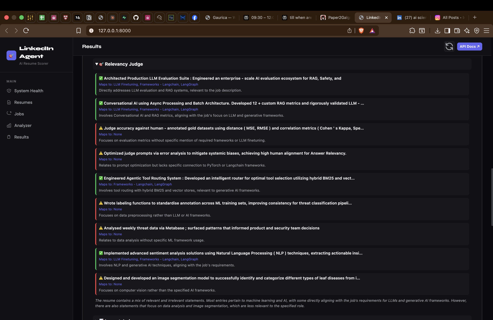
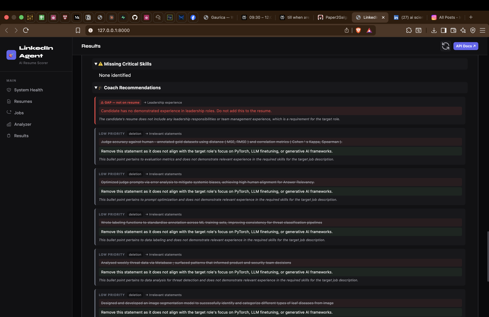

# hireable

An LLM-as-judge pipeline that scores resume-to-job fit across 5 independent dimensions, generates a tailored resume, and produces role-specific interview prep — running entirely locally via Ollama with no cloud dependency or API costs.

---

## Why this exists

Job applications involve two problems most tools ignore:

1. **Opaque scoring** — applicant tracking systems score resumes without explanation. You don't know if you're failing on skills, seniority match, domain fit, or something else.
2. **Generic advice** — "add more keywords" doesn't tell you which keywords, whether your experience framing is wrong, or whether you're applying to jobs above or below your actual level.

This pipeline makes scoring transparent and advice specific. Each judge explains its reasoning. The coach only rewrites bullets that already exist — it never invents experience or fabricates metrics. If a gap is real, it flags it as a gap rather than masking it.

The system runs locally because resume data is personal. Nothing leaves your machine.

---

## How it works

```
Resume + Job Description
         │
         ▼
┌────────────────────────────────────────┐
│         5 Parallel LLM Judges          │
│                                        │
│  Skills (25%)    → skill gap analysis  │
│  Experience (25%)→ depth + relevance   │
│  Seniority (20%) → level match         │
│  Relevancy (15%) → domain alignment    │
│  Impact (15%)    → quantified outcomes │
└────────────────────────────────────────┘
         │
         ▼
   Weighted score (0–100%)
         │
         ▼
┌────────────────────────────────────────┐
│            Coach Judge                 │
│                                        │
│  bullet_rewrite  → reframe existing    │
│  deletion        → remove irrelevant   │
│  gap_warning     → flag real gaps      │
└────────────────────────────────────────┘
         │
         ├─► Tailored resume  (results/tailored_resumes/)
         └─► Interview prep   (results/interview_prep/)
```

Each judge runs a structured prompt against the LLM, parses the JSON response, and returns a score + reasoning. The pipeline runs all 5 judges concurrently (asyncio) before the coach synthesises across them.

The coach deduplicates recommendations across judges before generating rewrites. `gap_warning` items are informational — they surface real skill gaps without pretending the resume can be edited to fix them.

---

## Model selection

The pipeline uses **`deepseek-r1:14b`** as the judge model. This was chosen after benchmarking all locally-available models across 6 resume-job pairs (including a deliberate wrong-fit pair to test discrimination).

Criteria ranked in order:
1. **Judge parse success rate** — does the model reliably return valid structured JSON across all 6 judges?
2. **Discrimination accuracy** — does it correctly score a Java engineer low against a Data Scientist role?
3. **Latency** — time per full pipeline run on local hardware

`deepseek-r1:14b` passed all 6 judges on all test pairs and correctly identified the wrong-fit case. Its chain-of-thought reasoning style (`<think>` tokens) produces more reliable structured output than instruction-tuned models that tend to hallucinate JSON fields or collapse scores to round numbers.

To run the benchmark yourself:

```bash
python benchmark_models.py
```

Results are written to `benchmark_results.json`. The pipeline uses whatever model you configure in `.env` — defaults to `deepseek-r1:14b`.

---

## Stack

| Layer | Technology | Why |
|-------|-----------|-----|
| Backend | FastAPI + Uvicorn | Async-native, suits concurrent judge calls |
| LLM runtime | Ollama | Local inference, model switching without code changes |
| Judge model | deepseek-r1:14b | Best structured-output reliability in benchmark |
| LLM client | LangChain Ollama | Thin wrapper for chat message formatting |
| Frontend | Single-file `dashboard.html` | Zero build step, no framework dependency |
| Data store | CSV | Portable, readable, easy to gitignore selectively |

---

## Setup

**Prerequisites:** [Ollama](https://ollama.com) installed and running.

```bash
# Pull the judge model
ollama pull deepseek-r1:14b
ollama serve
```

**Install dependencies:**

```bash
# Conda (recommended)
conda env create -f environment.yml
conda activate hireable

# Or pip
pip install -r requirements.txt
```

**Configure environment:**

```bash
cp .env.example .env
# Edit .env — set OLLAMA_MODEL if you want a different model
```

---

## Run

```bash
uvicorn linkedin_api:app --reload
```

Open `dashboard.html` in a browser (File → Open, or `open dashboard.html` on Mac).

1. Add a resume and job description via the dashboard
2. Click **Run Pipeline** — all 5 judges run concurrently, results appear in ~30–90s depending on hardware
3. From any result, click **Tailored Resume** or **Interview Prep**

---

## API endpoints

The FastAPI backend exposes:

| Endpoint | Description |
|----------|-------------|
| `POST /run-pipeline` | Run all 5 judges + coach on a resume-job pair |
| `POST /edit-resume` | Apply coach recommendations to generate tailored resume |
| `POST /interview-prep` | Generate role-specific questions + model answers |
| `GET /results` | List all saved pipeline results |
| `GET /resumes` | List resumes in data store |
| `GET /jobs` | List jobs in data store |

Auto-generated docs at `http://localhost:8000/docs` when server is running.

---

## Data files

Add your own data — all data files are gitignored after initial empty commit:

| File | Description |
|------|-------------|
| `data/resumes.csv` | Resumes — see `resumes.sample.csv` for format |
| `data/jobs.csv` | Job descriptions — see `jobs.sample.csv` for format |
| `data/labels.csv` | Optional human labels for evaluation |
| `data/skills_taxonomy.json` | 10 skill domains → canonical tokens used by skills judge |

To prevent git from tracking personal data after initial commit:

```bash
git update-index --skip-worktree data/resumes.csv data/jobs.csv data/labels.csv
```

---

## Results structure

All outputs are saved locally and never committed:

```
results/
├── pipeline/           # Full judge pipeline JSON per run
├── skills_judge/       # Individual judge outputs
├── experience_judge/
├── seniority_judge/
├── relevancy_judge/
├── impact_judge/
├── coach_judge/
├── tailored_resumes/   # Generated .txt files
├── interview_prep/     # Generated .json files
└── summary/            # Score summaries
```

---

## Project structure

```
hireable/
├── linkedin_api.py         # FastAPI app — all endpoints, resume edit logic
├── specialized_judges.py   # Judge prompts, LLM calls, JSON parsing, coach
├── chunker.py              # Text parsing and prompt formatting per judge
├── benchmark_models.py     # Model selection benchmark (run once per new model)
├── dashboard.html          # Frontend
├── data/
│   ├── resumes.csv             # gitignored after initial commit
│   ├── jobs.csv                # gitignored after initial commit
│   ├── labels.csv              # gitignored after initial commit
│   ├── skills_taxonomy.json    # skill domain → token mapping
│   ├── resumes.sample.csv      # format reference
│   └── jobs.sample.csv         # format reference
├── tests/
├── requirements_api.txt
├── environment.yml
└── .env.example
```

---

## Example output

Running an ML Engineer resume against a Data Scientist / GenAI Engineer role:

**Relevancy Judge** — maps each resume statement to job description domains, flags irrelevant content:



**Coach Recommendations** — gap warnings (not on resume, do not fabricate), deletions for irrelevant bullets, rewrites to surface transferable skills:



**Score breakdown** (same run):

```
Overall Match: 61.9%

┌──────────────┬────────┬────────┬──────────────────────────────────────────┐
│ Judge        │ Weight │  Score │ Key finding                              │
├──────────────┼────────┼────────┼──────────────────────────────────────────┤
│ Skills       │  25%   │  62.5% │ Missing: data modeling, forecasting, ROI │
│ Experience   │  25%   │  50.0% │ LLM/RAG depth strong; A/B testing absent │
│ Seniority    │  20%   │  75.0% │ Cross-functional ownership signals OK    │
│ Relevancy    │  15%   │  75.0% │ 3 of 4 resume sections map to JD domain  │
│ Impact       │  15%   │  50.0% │ Directional bullets; few hard numbers    │
└──────────────┴────────┴────────┴──────────────────────────────────────────┘
```

Coach recommendations (3 generated, 2 actionable):

```
gap_warning  [high]    data modeling — genuine gap, not addressable by rewrite
gap_warning  [high]    forecasting — genuine gap, not addressable by rewrite
bullet_rewrite         "Conducted analysis of weekly threat data through Metabase"
                    →  "Delivered weekly threat analysis via Metabase, surfacing
                        actionable security patterns for product and security teams"
```

Tailored resume applies the `bullet_rewrite` items; `gap_warning` items appear as
honest gaps in interview prep rather than being papered over.

---

## Limitations

**Claims are not verified.** The judges score what the resume says. A fabricated metric or exaggerated title passes if it's plausible. The system rewards well-written resumes, not necessarily accurate ones.

**PDF extraction quality matters.** Resume text is extracted before judges run. Scanned PDFs, two-column layouts, and graphics-heavy templates produce garbled text that degrades all five scores. Plain text or single-column PDFs extract cleanly.

**Skills not in the taxonomy get missed.** The skills judge uses `data/skills_taxonomy.json` as a token vocabulary. Niche or emerging tools not in that file will be labelled missing even if present in the resume. Extend the taxonomy file to fix this.

**Job URL scraping is best-effort.** Works on Greenhouse, Lever, Workable, and most company career pages. Fails on LinkedIn (requires auth) and JavaScript-heavy SPAs that render content client-side. For those, paste the JD text manually.

**Scores don't predict hiring outcomes without calibration.** The judges measure resume-to-JD textual fit, not recruiter preferences, team culture, or the unwritten requirements in every real role. Use the eval harness (`python eval.py`) with labelled outcomes to measure correlation against actual interview results in your context.

**Local inference speed.** A full pipeline run takes 30–90 seconds on a modern Mac with `deepseek-r1:14b` loaded. Cold start adds ~20s.

---

## Scoring internals

The LLM's job is structured extraction, not scoring. Each judge returns a JSON array of labelled items. All arithmetic happens in Python after the LLM responds.

**Skills & Experience — partial credit formula**

The LLM labels each required skill/responsibility as `present (1)`, `partial (0.5)`, or `missing (0)`:

```
score = (present + 0.5 × partial) / total
```

A skill mentioned once with no depth counts as partial. A skill with clear usage evidence counts as present.

**Seniority — binary demonstrated/absent**

The LLM identifies seniority signals expected for the role (e.g. "led cross-functional teams", "owned a roadmap"). Each is labelled `demonstrated (1)` or `absent (0)`. No partial credit.

```
score = demonstrated / total
```

Red flags (e.g. level mismatch indicators) are surfaced separately and don't affect the numeric score.

**Relevancy — binary relevant/irrelevant**

Each resume statement is labelled `relevant (1)` or `irrelevant (0)` to the specific job domain.

```
score = relevant / total
```

**Impact — quantified vs directional vs unquantified**

Each impact statement gets one of three labels:
- `quantified (1)` — contains a real number or percentage
- `directional (0.5)` — implies improvement without a number ("reduced latency", "improved accuracy")
- `unquantified (0)` — vague or purely descriptive

```
score = (quantified + 0.5 × directional) / total
```

**Final weighted score**

```
overall = skills×0.25 + experience×0.25 + seniority×0.20 + relevancy×0.15 + impact×0.15
```

Weights are defined in `JUDGE_DEFAULT_WEIGHTS` in `specialized_judges.py` and can be overridden per request.

This two-stage design — LLM extracts and labels, Python scores — means the score is deterministic given the LLM's labels. Inconsistency shows up as label noise, which is easier to debug than an LLM producing a raw number with no audit trail.

---

## Design decisions

**Why 5 separate judges instead of one prompt?** A single "score this resume" prompt conflates criteria and produces inconsistent weights. Separate judges with fixed weights produce stable, interpretable scores — you can see exactly which dimension is dragging your score down.

**Why no fabricated metrics?** The coach prompt explicitly bans placeholders like `[X%]` or `[Insert metric]`. If no real number exists in your resume, the rewrite drops the metric entirely rather than inventing one. A reviewer noticing a fake metric is worse than a bullet with no metric.

**Why local inference?** Resume text contains personal career history. Running on Ollama means no data leaves your machine, no API rate limits, and no per-run cost.
