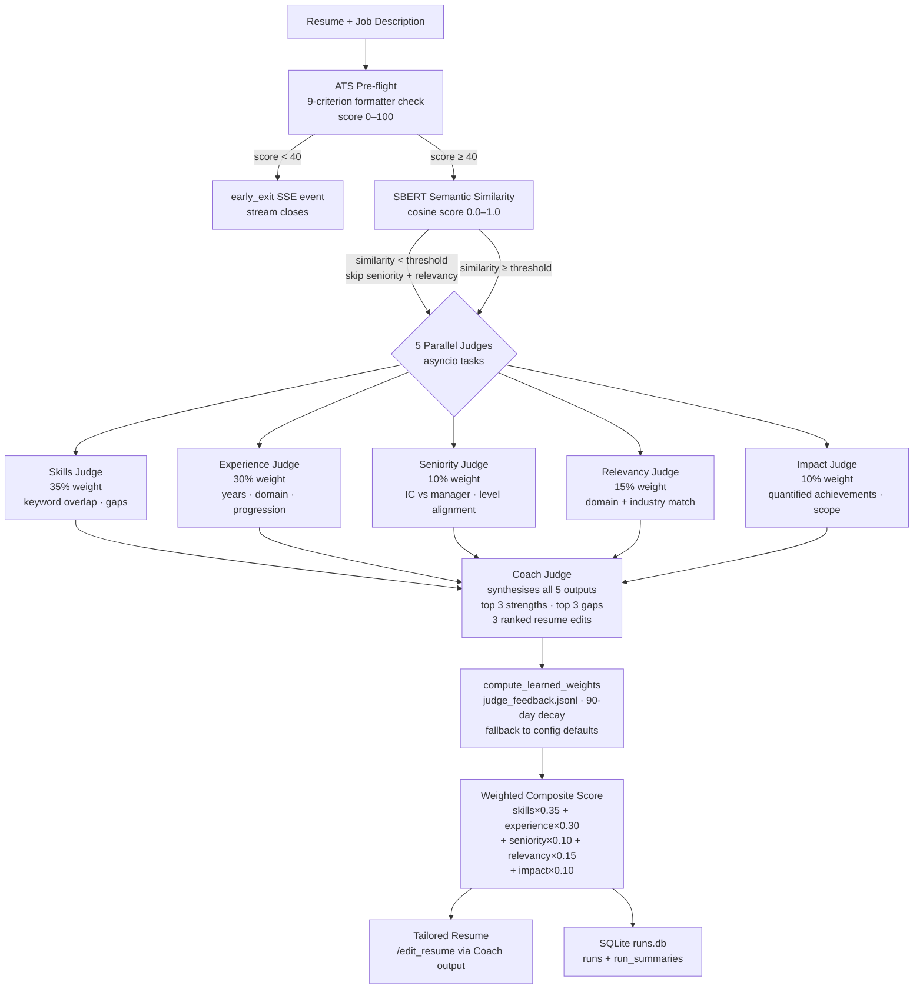
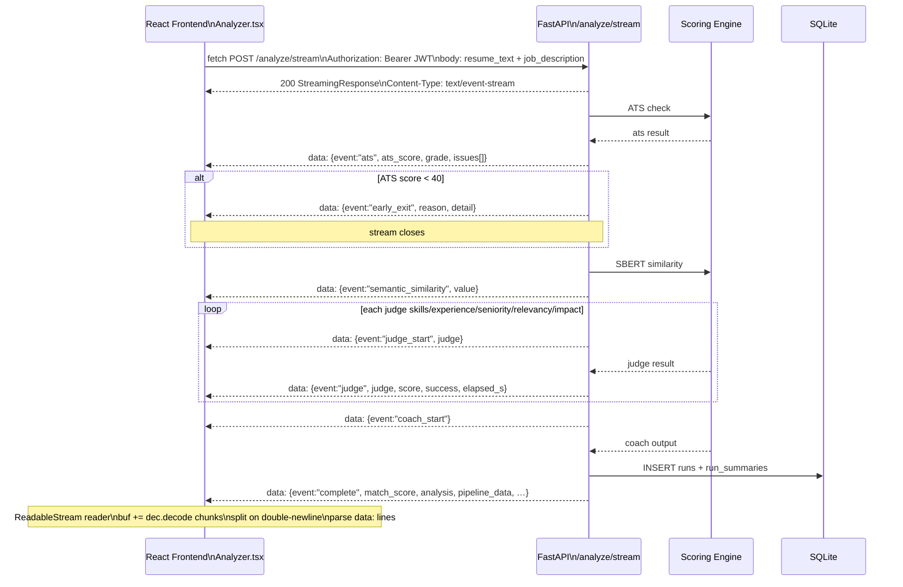
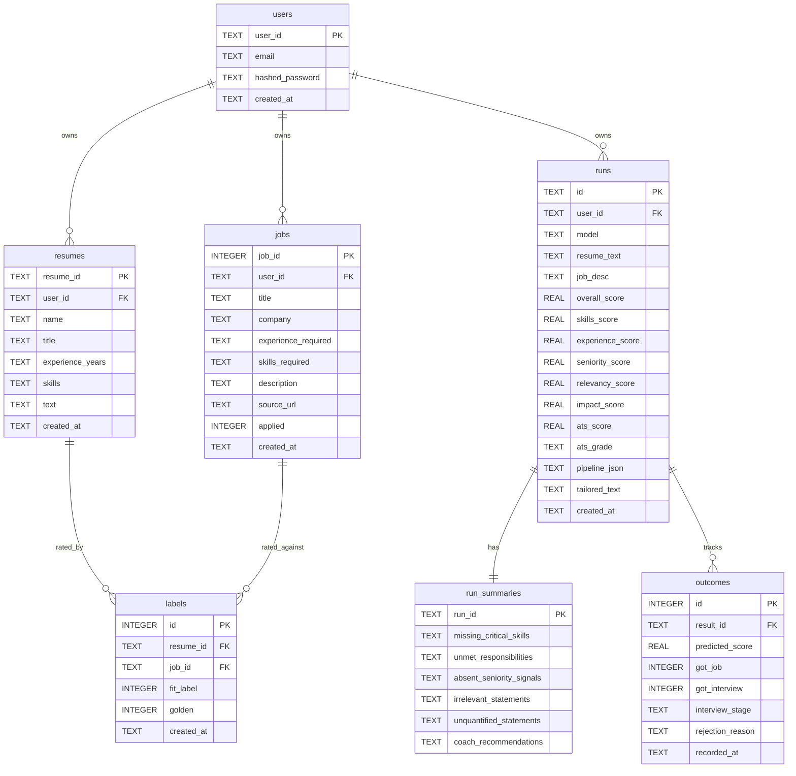

# Software Design Document — Hireable

## 1. System Overview

Hireable is a resume-to-job-description scoring engine that evaluates candidate fit using a multi-judge LLM pipeline. Users upload a resume, paste job descriptions, and receive a composite score plus structured coaching feedback. A batch scorer processes large JD sets overnight. A kappa evaluation harness measures inter-rater reliability between the pipeline and human labellers.

**Runtime modes:**
- Interactive (FastAPI + React frontend, single JD)
- Batch (CLI, N JDs against one resume)
- Kappa eval (offline blind-sheet export + agreement calculation)

---

## Architecture Decisions

| Decision | Choice | Why | Tradeoff |
|----------|--------|-----|----------|
| Scoring pipeline | 5 independent LLM judges (skills, experience, seniority, relevancy, impact) | Each judge evaluates one dimension with focused context — reduces prompt length, improves JSON reliability, makes failures per-dimension rather than catastrophic; easier to tune one judge without affecting others | 5+ LLM calls per analysis adds latency; prompts must be kept consistent across judges; a single well-structured prompt might be sufficient for a simpler use case |
| Single-prompt alternative | Not used | A single "score everything" prompt consistently produces inconsistent JSON, conflates dimensions, and makes attribution impossible | N/A |
| LLM provider | Ollama (local) + OpenRouter (cloud) as mutually selectable backends | Ollama = zero cost + data privacy for development; OpenRouter = access to larger models (70B+) when accuracy matters; same interface, switchable via env var | Ollama limited to hardware-local model size; OpenRouter has per-token cost and internet dependency; two backend paths means any prompt change must be tested on both |
| Database | SQLite | No infra setup — single file, zero config, ships with Python; appropriate for single-user or small-team use; fast for the read patterns in this app (paginated history, single-run fetch) | No concurrent writes (SQLite write lock); no JSONB query support — all structured data stored as TEXT JSON and parsed in Python; migration path to Postgres documented but not yet implemented |
| Semantic similarity | SBERT (Sentence-BERT) cosine similarity | Provides a fast, embedding-based domain-match signal that complements keyword overlap; runs locally, no API call; loaded once at startup and cached | Adds a model to the startup (memory + load time); SBERT embeddings are general-purpose — a fine-tuned model on job description/resume pairs would perform better; cosine similarity doesn't account for asymmetry (resume summary vs JD summary are different text types) |
| Composite scoring | Python arithmetic (weighted sum, not LLM-computed) | Deterministic and reproducible — same inputs always produce the same score; arithmetic is auditable and debuggable; separates the "evaluate" step (judges) from the "aggregate" step | Weights are static defaults unless feedback has accumulated — early users get the same weights regardless of their specific job market; a learned weighting system improves over time but requires outcome data |
| Weight learning | Feedback-derived via judge_feedback.jsonl + time-decay accuracy | Ties judge weights to real hiring outcomes (interview/job signals); time decay ensures stale data doesn't dominate; falls back to config defaults until min_feedback_samples threshold is reached | Requires users to actually record outcomes — adoption friction; small feedback sets are statistically noisy; 90-day half-life is a fixed hyperparameter not tuned per user |
| Streaming protocol | SSE via fetch + ReadableStream (not EventSource, not WebSockets) | SSE fits the unidirectional server→client stream; `EventSource` API cannot set custom headers (no JWT), so `fetch` with streaming body is required; simpler than WebSockets (no bidirectional channel needed) | SSE requires the connection to stay open for the full pipeline duration; proxy buffering requires backend padding (≥1536 bytes per frame); `fetch` streaming has less browser tooling support than EventSource |
| Frontend stack | React + Vite (TypeScript) | Fast dev server, native ESM, minimal config; React component model fits the multi-panel dashboard layout; TypeScript catches SSE event shape errors at compile time | Next.js would add SSR, routing, and deployment infrastructure without benefit for a single-user local tool; Vite adds a build step that bare HTML/JS avoids |
| Eval methodology | Cohen's kappa (vs accuracy-only) | Kappa corrects for chance agreement — a pipeline that always predicts "possible fit" gets near-zero kappa even if it matches human labels 40% of the time; forces genuine calibration between pipeline and human raters | Kappa requires at least two raters per item to be meaningful; quadratic weighted kappa would better handle ordinal label distance (strong/possible/no fit); accuracy reporting is still useful for stakeholder communication |

---

## Architecture Diagram

### Full Analysis Pipeline



### SSE Streaming Flow



### Database ER Diagram



---

## 2. Architecture

```
┌─────────────────────────────────────────────────────────┐
│  React Frontend (Vite + TypeScript)                     │
│  Pages: Dashboard, Analyzer, History, Settings          │
└───────────────────┬─────────────────────────────────────┘
                    │ REST + SSE
┌───────────────────▼─────────────────────────────────────┐
│  FastAPI Backend (Python)                               │
│  ┌──────────────┐ ┌────────────┐ ┌────────────────────┐ │
│  │ /api/jobs    │ │ /api/auth  │ │ /api/analyze (SSE) │ │
│  └──────────────┘ └────────────┘ └────────────────────┘ │
│  ┌───────────────────────────────────────────────────┐   │
│  │  Scoring Engine                                   │   │
│  │  ATS Checker → 5 Judges → Coach Judge → Composite│   │
│  └───────────────────────────────────────────────────┘   │
└───────────────────┬─────────────────────────────────────┘
                    │
        ┌───────────┴──────────┐
        │                      │
┌───────▼──────┐     ┌─────────▼────────┐
│  SQLite DB   │     │  LLM Backends    │
│  runs.db     │     │  Ollama (local)  │
│              │     │  OpenRouter      │
└──────────────┘     └──────────────────┘
```

---

## 3. Components

### 3.1 ATS Checker

Pre-filter before any LLM call. Parses resume for formatting red flags: missing contact info, tables detected via whitespace heuristics, columns (two-column layouts), images, missing section headers, non-standard fonts. Outputs an ATS score (0-100).

**Gate:** If ATS score < 40, emits `early_exit` SSE event and halts. No judge calls made.

### 3.2 Five-Judge Pipeline

Each judge is an independent LLM prompt returning a structured JSON score. Judges run sequentially per JD.

| Judge | Weight | What it evaluates |
|-------|--------|-------------------|
| Skills | 35% | Skill keyword overlap, proficiency signals, missing critical skills |
| Experience | 30% | Years of experience, domain depth, progression quality |
| Seniority | 10% | Level alignment (IC vs manager, junior vs senior) |
| Relevancy | 15% | Domain and industry match |
| Impact | 10% | Quantified achievements, business outcomes, scope |

Weights are default values. All are overridable via env vars (`ANALYSER_WEIGHT_SKILLS` etc). Learned weights from outcome feedback can further shift these per-user at runtime.

Each judge returns: `{ score: 0-100, reasoning: string, gaps: string[] }`.

### 3.3 Coach Judge

Synthesises all five judge outputs into actionable feedback. Not scored — output only. Generates: top 3 strengths, top 3 gaps, 3 specific resume edits ranked by impact.

### 3.4 Composite Scorer

```
composite = (skills × 0.35) + (experience × 0.30) + (seniority × 0.10)
          + (relevancy × 0.15) + (impact × 0.10)
```

Result stored in `runs` table with full judge breakdown JSON.

### 3.5 Semantic Similarity (SBERT)

Sentence-BERT embeddings computed for resume summary + JD summary. Cosine similarity used as a signal fed to the relevancy judge, not as a standalone score. Model loaded once at startup, cached in memory.

### 3.6 Learned Weights System

`analysers/weights.py` derives judge weights from real outcome feedback rather than static per-user overrides. When `/record_outcome` is called with interview/job results, it appends entries to `data/judge_feedback.jsonl` — one record per judge, per signal (`got_interview` trains skills/experience/seniority/relevancy; `got_job` trains impact/overall).

`compute_learned_weights()` reads that file, groups entries by judge, and computes time-decayed prediction accuracy (exponential decay with 90-day half-life). A judge's learned weight is proportional to its accuracy — judges that predicted outcomes correctly get more weight. Weights are normalised to sum to 1.0.

Falls back to `cfg.default_weights` (from `analysers/config.py`) for any judge with fewer than `cfg.min_feedback_samples` (default 3) entries. When the feedback file is absent entirely, all weights use config defaults.

Applied at composite calculation time in both `/analyze` and `/analyze/stream` — if `source == "learned"`, the engine calls `calculate_overall_match()` with the derived weights; otherwise default weights apply.

### 3.7 Batch Scorer

CLI entry: `python scripts/batch_score.py --resume <path> --jobs <sqlite-db> --user-id <uuid>`

- Reads all JDs from `jobs` table for the given user
- Runs full pipeline on each JD sequentially
- Writes results to `runs` table
- Prints progress to stdout, writes summary CSV on completion
- PID and run parameters logged to allow resume on failure

### 3.8 Kappa Evaluation Harness

`scripts/kappa.py` — measures inter-rater reliability between pipeline scores and human labels.

**Export:** `python scripts/kappa.py export --jobs 1-12 --out data/kappa_java.csv`
- Produces blind CSV with job text, no scores — for human labellers

**Calculate:** `python scripts/kappa.py calculate --human data/kappa_java_labelled.csv --pipeline data/runs.db`
- Computes Cohen's kappa across label categories (strong fit / possible fit / no fit)

---

## 4. Data Structures

### 4.1 SQLite Schema (`runs.db`)

**`users`**
```
user_id TEXT PK (UUID)
email TEXT UNIQUE NOT NULL
hashed_password TEXT NOT NULL
created_at TEXT NOT NULL
```

**`jobs`**
```
job_id INTEGER PK AUTOINCREMENT
user_id TEXT → users
title TEXT NOT NULL
company TEXT
experience_required TEXT
skills_required TEXT
description TEXT
source_url TEXT
applied INTEGER DEFAULT 0
created_at TEXT NOT NULL
```

**`resumes`**
```
resume_id TEXT PK (UUID)
user_id TEXT → users
name TEXT
title TEXT
experience_years TEXT
skills TEXT          -- comma-separated, plain TEXT
text TEXT            -- raw extracted text
created_at TEXT
```

**`runs`**
```
id TEXT PK (UUID)
user_id TEXT → users
created_at TEXT
model TEXT
candidate_name TEXT
job_title TEXT
resume_text TEXT
job_desc TEXT
overall_score REAL
skills_score REAL
experience_score REAL
seniority_score REAL
relevancy_score REAL
impact_score REAL
ats_score REAL
ats_grade TEXT
skills_gate_applied INTEGER DEFAULT 0
pipeline_json TEXT   -- JSON-encoded, validated on write; full judge breakdown with raw_response stripped
tailored_text TEXT
ats_validation_json TEXT  -- JSON-encoded, validated on write
```

**`run_summaries`** (denormalized, written alongside `runs` for fast list views — list_results never deserialises `pipeline_json`)
```
run_id TEXT PK → runs (ON DELETE CASCADE)
missing_critical_skills TEXT DEFAULT '[]'   -- JSON-encoded, validated on write
unmet_responsibilities TEXT DEFAULT '[]'    -- JSON-encoded, validated on write
absent_seniority_signals TEXT DEFAULT '[]'  -- JSON-encoded, validated on write
irrelevant_statements TEXT DEFAULT '[]'     -- JSON-encoded, validated on write
unquantified_statements TEXT DEFAULT '[]'   -- JSON-encoded, validated on write
coach_recommendations TEXT DEFAULT '[]'     -- JSON-encoded, validated on write
```

**`outcomes`**
```
id INTEGER PK AUTOINCREMENT
result_id TEXT NOT NULL
predicted_score REAL
got_job INTEGER
got_interview INTEGER
interview_stage TEXT    -- phone_screen | technical | final | offer
rejection_reason TEXT   -- skills_gap | seniority_mismatch | culture_fit | compensation | other
recorded_at TEXT
```

**`labels`** (human labels for kappa evaluation)
```
id INTEGER PK AUTOINCREMENT
resume_id TEXT NOT NULL
job_id TEXT NOT NULL
fit_label INTEGER NOT NULL
golden INTEGER DEFAULT 0
created_at TEXT
```

> **SQLite note:** SQLite has no JSONB or array types. All structured values (judge outputs, coach output, taxonomy aliases, summary arrays) are stored as `TEXT` containing JSON-encoded strings. Serialisation happens at write time in `db.py`; callers receive parsed Python objects.

### 4.2 SSE Event Stream (`/analyze/stream`)

All frames are newline-delimited `data: <json>\n\n`. Each JSON object has an `event` discriminator field.

```
{ event: "ats",                data: { ats_score, grade, issues[] }, elapsed_s }
{ event: "early_exit",         reason: "ats_formatting", detail: string, elapsed_s }
{ event: "semantic_similarity", value: 0.0–1.0, elapsed_s }
{ event: "judge_start",        judge: "skills"|"experience"|"seniority"|"relevancy"|"impact", elapsed_s }
{ event: "judge",              judge: string, score: 0–100, success: bool, elapsed_s, pipeline_elapsed_s }
{ event: "coach_start",        elapsed_s }
{ event: "complete",           match_score, total_elapsed_s, metrics: {}, analysis: {}, pipeline_data, ats_preflight, semantic_similarity, suspect_scores, metadata: {} }
{ event: "error",              detail: string }
{ event: "tick" }   // heartbeat only, no data fields — emitted during long judge waits
```

`early_exit` fires when ATS score falls below the threshold (default 40); no judge calls are made. Seniority and relevancy judges are skipped when `semantic_similarity` signals a domain mismatch.

---

## 5. API Interfaces

All routes require `Authorization: Bearer <JWT>` unless noted. If `API_KEY` env var is set, an additional `X-API-Key` header (or Bearer token) is required on all non-public paths. Public paths: `/`, `/favicon.ico`, `/auth/*`.

| Method | Route | Description |
|--------|-------|-------------|
| POST | `/auth/register` | Create account, return JWT |
| POST | `/auth/login` | Verify credentials, return JWT |
| GET | `/auth/me` | Return current user's id + email |
| POST | `/analyze` | Run full 5-judge + coach pipeline (JSON) |
| POST | `/ats-check` | Instant 9-criterion ATS scan, no LLM |
| POST | `/ats-deep-audit` | 4-dimension LLM deep audit |
| POST | `/skill-match` | Score resume against 20 income paths |
| POST | `/edit_resume` | Apply coach → return tailored resume |
| POST | `/interview_prep` | Generate role-specific interview questions |
| GET | `/list_results` | Paginated run history |
| POST | `/fetch-job-url` | Scrape JD from URL |
| POST | `/parse-jd-text` | Parse pasted JD text via LLM |
| POST | `/extract-pdf` | Extract + structure PDF resume |
| GET | `/resumes` | List uploaded resumes |
| POST | `/resumes` | Add resume |
| DELETE | `/resumes/{id}` | Delete resume |
| GET | `/jobs` | List jobs |
| POST | `/jobs` | Add job |
| DELETE | `/jobs/{id}` | Delete job |
| PATCH | `/jobs/{id}/applied` | Toggle applied status |
| GET | `/health` | API + Ollama + DB status |
| GET | `/ollama-models` | List installed Ollama models |
| GET | `/openrouter-models` | List configured OpenRouter models (OPENROUTER_MODEL_N) |
| POST | `/benchmark-ollama` | Synthetic model benchmark (all Ollama models) |
| POST | `/benchmark-ollama-real` | Real-data model benchmark |
| GET | `/benchmark-ollama-results` | Cached synthetic benchmark results |
| GET | `/benchmark-ollama-real-results` | Cached real benchmark results |
| POST | `/benchmark-models` | OpenRouter model benchmark (synthetic) |
| POST | `/summarize_result` | AI summary of a saved run |
| POST | `/record_outcome` | Log interview/job outcome for weight learning |
| POST | `/run_evals` | Run faithfulness audit on pipeline results |
| GET | `/client-config` | Provider/model/key config for UI pre-fill |

---

## 6. Key Algorithms

### Resume Parsing
1. Extract text via `pdfminer` or `python-docx`
2. Split into sections via regex on header keywords (EXPERIENCE, EDUCATION, SKILLS, etc.)
3. Extract contact block (email, phone, LinkedIn) from top ~10 lines
4. Skills extracted by matching against `skills_taxonomy` aliases (case-insensitive)

### ATS Scoring
- Each red flag carries a penalty weight
- Table detected: -30
- Missing contact: -20
- Two-column layout: -20
- Missing standard headers: -10 each (capped at -20)
- Score = 100 - sum(penalties), floor 0

### Semantic Similarity
```python
resume_embedding = sbert_model.encode(resume_summary)
jd_embedding = sbert_model.encode(jd_summary)
similarity = cosine_similarity(resume_embedding, jd_embedding)  # 0.0 – 1.0
```
Passed to relevancy judge as `context.semantic_similarity`.

### Composite with Custom Weights
```python
weights = compute_learned_weights(feedback_file)  # falls back to env-var or config defaults
composite = sum([
    skills_score * weights["skills"],       # default 0.35
    experience_score * weights["experience"], # default 0.30
    seniority_score * weights["seniority"],  # default 0.10
    relevancy_score * weights["relevancy"],  # default 0.15
    impact_score * weights["impact"],        # default 0.10
])
```

---

## 7. Auth Flow

1. Register: email + password (min 8 chars) → `bcrypt` hash stored → UUID generated → JWT signed with `JWT_SECRET` env var (falls back to auto-generated key stored in `data/.jwt_secret`)
2. Login: verify hash → issue JWT (expires **7 days**, HS256 algorithm)
3. All API routes: `Authorization: Bearer <token>` → decoded via `python-jose` → `user_id` extracted
4. Optional `API_KEY` env var enables additional middleware-level key protection (X-API-Key header)
5. Frontend stores JWT in `localStorage`, attaches to every request header

---

## 8. LLM Backend Configuration

Controlled via env vars:

| Var | Default | Purpose |
|-----|---------|---------|
| `OLLAMA_BASE_URL` | `http://127.0.0.1:11434` | Ollama endpoint |
| `ANALYSER_DEFAULT_MODEL` | `cogito:14b` | Primary model for heavy judges (skills, experience, coach) |
| `ANALYSER_FAST_MODEL` | `phi4-mini:latest` | Lightweight model for binary judges (seniority, relevancy, impact) |
| `ANALYSER_FALLBACK_MODEL` | `phi4-mini:latest` | Fallback when primary model exhausts retries |
| `OPENROUTER_API_KEY` | — | Auto-activates OpenRouter when set |
| `OPENROUTER_DEFAULT_MODEL` | `meta-llama/llama-3.3-70b-instruct:free` | OpenRouter heavy model |
| `OPENROUTER_FAST_MODEL` | `nvidia/nemotron-nano-9b-v2:free` | OpenRouter fast model |
| `OPENROUTER_MODEL_N` | — | Pool entries for benchmark; `OPENROUTER_KEY_N` pairs each |
| `ANALYSER_TWO_PHASE` | `false` | Enable two-phase hypothesis→challenge judge mode (API only) |
| `JWT_SECRET` | auto-generated | JWT signing key; persisted in `data/.jwt_secret` if not set |
| `API_KEY` | — | Optional middleware API key guard (X-API-Key header) |
| `ALLOWED_ORIGINS` | `*` | CORS allowed origins (comma-separated) |

> **CORS/Security note:** In production, set `ALLOWED_ORIGINS` to the exact frontend domain (e.g. `https://app.hireable.ai`). Using `*` with `allow_credentials=True` is rejected by browsers per the CORS spec — credentialed requests require an explicit origin, not a wildcard — and weakens origin protection. The app already emits a `warnings.warn` at startup when `*` is detected.

Ollama and OpenRouter are mutually selectable — if `OPENROUTER_API_KEY` is set, OpenRouter is used; otherwise Ollama. Heavy/fast model split applies to both backends.

---

## 9. Data Flow — Single Analysis

```
User selects resume + JD
        │
        ▼
POST /analyze/stream (fetch + ReadableStream)
        │
        ▼
ATS Checker → emit ats event
        │ score < threshold → emit early_exit → close stream
        │ score ≥ threshold
        ▼
SBERT semantic similarity → emit semantic_similarity event
        │ similarity < mismatch_threshold → skip seniority + relevancy judges
        ▼
5 judges dispatched concurrently as asyncio tasks (heavy→default model, fast→fast model)
        │ each judge emits judge_start then judge event on completion
        ▼
Coach Judge (all completed judge outputs as context) → emit coach_start
        │
        ▼
Composite calculation
  compute_learned_weights() → if source=="learned": apply derived weights
                             → else: apply cfg.default_weights (35/30/10/15/10)
        │
        ▼
Write to runs + run_summaries tables
        │
        ▼
emit complete event → stream ends
```

---

## 10. Frontend Architecture

**Pages:**
- `Dashboard` — resume list + JD list, trigger analysis
- `Analyzer` — SSE progress UI, score display, coach feedback
- `History` — paginated run history, filter by date/score
- `Settings` — weight sliders, LLM provider config

**State management:** React Context for auth (JWT, user). Local component state for analysis stream. No global store.

**Streaming in Analyzer.tsx:**

The frontend does not use `EventSource`. It uses `fetch()` with `ReadableStream` — this is required because `EventSource` does not support setting custom headers, so it cannot pass the `Authorization: Bearer <token>` JWT.

```typescript
const res = await fetch('/analyze/stream', {
  method: 'POST',
  headers: { 'Content-Type': 'application/json', Authorization: `Bearer ${token}` },
  body: JSON.stringify({ resume_text, job_description, use_coach, llm_models, ... }),
  signal,
})
const reader = res.body.getReader()
const dec = new TextDecoder()
let buf = ''
while (true) {
  const { done, value } = await reader.read()
  if (done) break
  buf += dec.decode(value, { stream: true })
  // split on double-newline SSE frame boundaries, parse 'data: ...' lines
  for (const part of buf.split('\n\n')) {
    const line = part.split('\n').find(l => l.startsWith('data: '))
    if (line) handleEvent(JSON.parse(line.slice(6)))
  }
}
```

Events dispatched: `ats`, `judge_start`, `judge` (one per judge), `coach_start`, `semantic_similarity`, `complete`, `early_exit`, `error`, `tick` (heartbeat). Each event object carries an `event` field discriminating type. The backend pads each SSE frame to ≥ 1536 bytes to prevent proxy buffering.

---

## 11. What Can Be Built Next

**High-value, near-term:**
- **Multi-resume support per run**: score same JD against 3 resume versions simultaneously — shows which version wins and by how much
- **Resume diff view**: when user edits resume, show delta in composite score with attribution (which judge moved)
- **JD keyword extractor**: highlight which JD terms are present/absent in resume, visible inline
- **Export**: PDF report per run (score card + coach notes), shareable link

**Medium-term:**
- **Kappa dashboard**: once labelling session done, visualise pipeline vs human agreement per judge, identify weakest judge
- **Calibration mode**: when kappa < 0.6 on a judge, surface the disagreed-on examples for prompt tuning
- **Application tracker**: add status column to jobs (applied / screened / interview / offer / rejected), pipeline graph view
- **Cover letter generator**: given resume + JD + coach gaps, generate targeted cover letter para per gap

**Architectural:**
- **Async batch via queue**: replace synchronous batch_score.py with a task queue (Celery/RQ) — allows concurrent batch runs, progress via websocket
- **Embedding cache**: store SBERT embeddings per resume/JD chunk, skip recomputation on re-score
- **Prompt versioning**: track which prompt version produced each run — enables A/B comparison when prompts change
